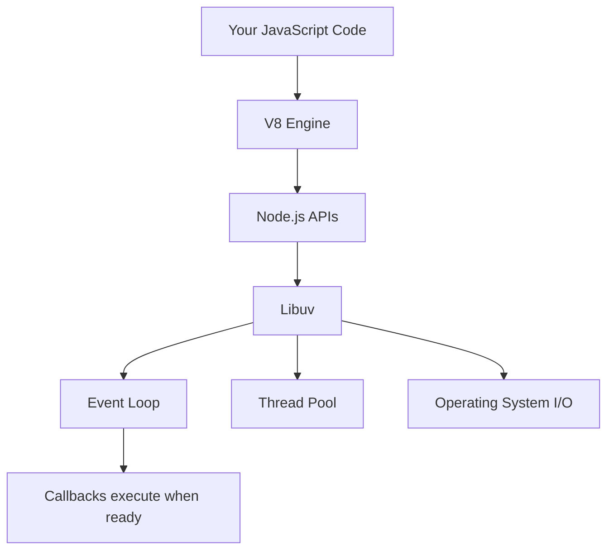
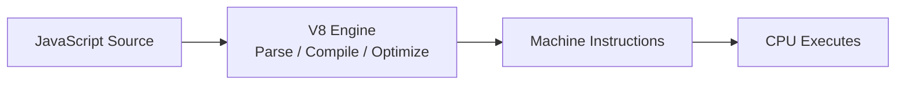
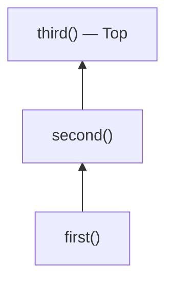
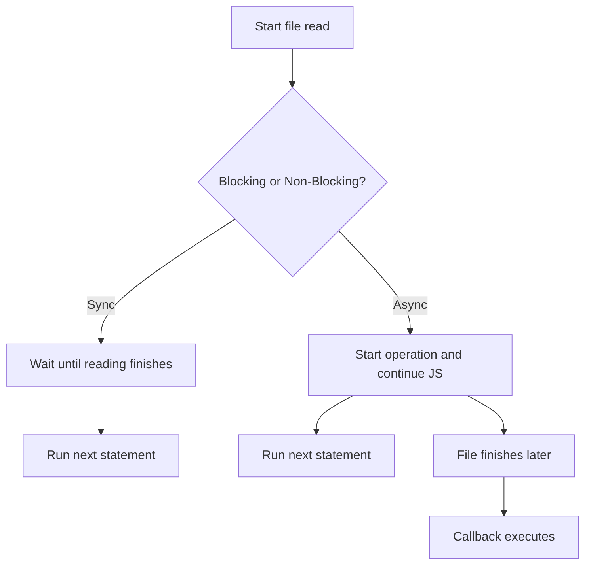
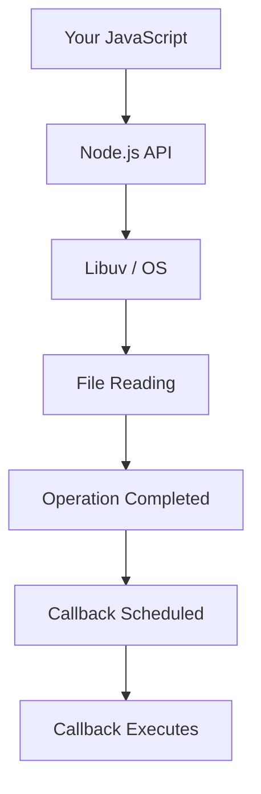
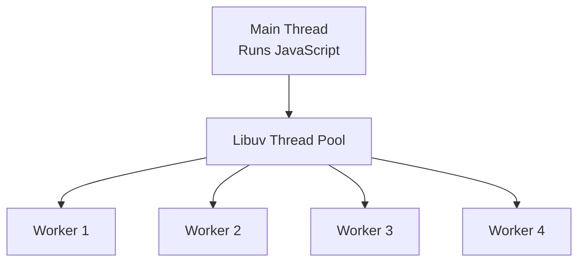
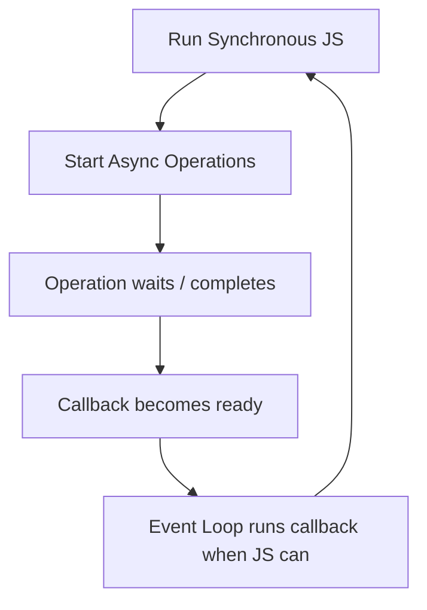
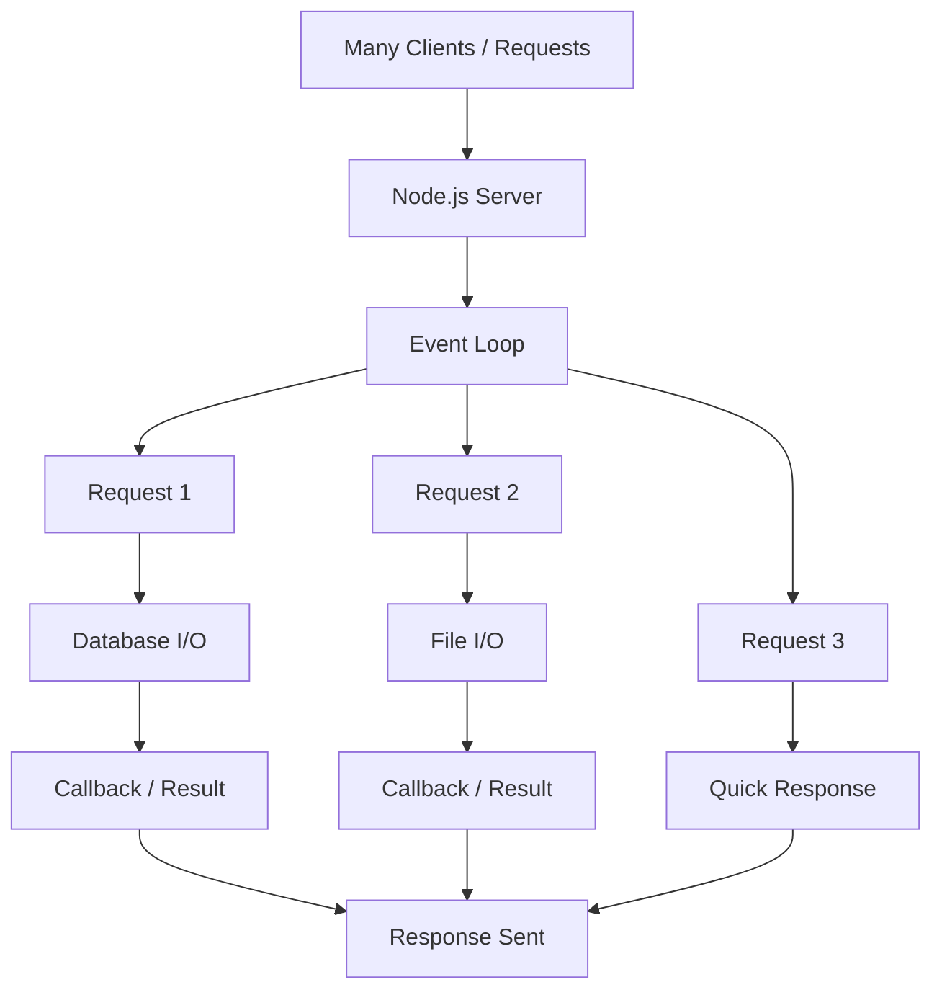

# 🟢 Node.js Backend Mastery
## Lesson 02 — Node.js Architecture

> شرح بالمصري البسيط، أمثلة عملية، ورسومات توضيحية. هدفنا نفهم Node.js بيشتغل إزاي من جوه، مش نحفظ المصطلحات.

## 📚 محتويات الدرس
1. [Node.js بيشتغل إزاي؟](#1-nodejs-بيشتغل-إزاي)
2. [Architecture Components](#2-nodejs-architecture-components)
3. [V8 Engine](#3-v8-engine--عقل-تنفيذ-javascript)
4. [Call Stack](#4-call-stack--مكان-تنفيذ-الكود)
5. [Blocking vs Non-Blocking](#5-blocking-vs-non-blocking)
6. [Libuv](#6-libuv)
7. [Thread Pool](#7-thread-pool)
8. [Event Loop](#8-event-loop)
9. [Event Loop Phases](#9-event-loop-phases)
10. [setTimeout vs setImmediate](#10-settimeout-vs-setimmediate)
11. [Microtasks](#11-microtasks)
12. [مثال شامل](#12-مثال-شامل)
13. [Requests في Node.js](#13-nodejs-بيتعامل-مع-requests-كتير-إزاي)
14. [I/O Bound vs CPU Bound](#14-io-bound-vs-cpu-bound)
15. [Interview Questions](#15-interview-questions)
16. [Assignments](#16-assignments)

---

# 1. Node.js بيشتغل إزاي؟

خلينا نشوف المثال ده:

```js
console.log("Hello");

setTimeout(() => {
  console.log("Finished");
}, 2000);

console.log("Welcome");
```

ممكن تتوقع إن البرنامج يطبع Hello، يستنى ثانيتين، يطبع Finished، وبعدها Welcome.

لكن الـ Output الحقيقي:

```text
Hello
Welcome
Finished
```

### ليه؟

لأن `setTimeout` مش بتوقف البرنامج كله عشان تستنى. Node.js بيسجل الـ Timer وبيكمل تنفيذ الكود اللي بعده. لما الوقت يعدّي والـ Callback تبقى جاهزة، تتنفذ في الوقت المناسب.

أهم فكرة:

> **Node.js uses a non-blocking, event-driven architecture.**

- **Non-Blocking I/O:** بدل ما البرنامج يقف مستني عملية، يقدر يكمل شغل تاني.
- **Event-Driven:** البرنامج بيتعامل مع Events، ولما حدث يحصل، الـ Callback المناسبة تتنفذ.

---

# 2. Node.js Architecture Components

Node.js مجموعة مكونات بتشتغل مع بعض:



بشكل مبسط:
1. **JavaScript Code:** الكود اللي إحنا بنكتبه.
2. **V8 Engine:** المحرك اللي بيشغّل JavaScript.
3. **Node.js APIs:** بتوفر إمكانيات زي التعامل مع الملفات والـ Network.
4. **Libuv:** بتساعد في إدارة الـ asynchronous operations والـ Event Loop وبعض مهام الخلفية.
5. **Event Loop:** بتنظم تنفيذ الـ callbacks لما تكون جاهزة.
6. **Thread Pool:** مجموعة Threads بتستخدمها Libuv لبعض العمليات.

---

# 3. V8 Engine — عقل تنفيذ JavaScript

الـ **V8 Engine** هو JavaScript Engine طورته Google، وبيستخدم في Chrome، وNode.js بيستخدمه لتشغيل JavaScript خارج المتصفح.

```js
const x = 10;
const y = 20;

console.log(x + y);
```

مين اللي بيشغّل JavaScript؟ **V8 Engine**.

بشكل مبسط، V8:
1. بياخد JavaScript Code.
2. بيحلله.
3. بيحوّله لتمثيل داخلي.
4. بيترجم الأجزاء المناسبة إلى Machine Code باستخدام تقنيات التنفيذ والتحسين.
5. ينفذ الكود.



### نقطة مهمة
V8 مسؤول عن تنفيذ JavaScript، لكنه مش مسؤول لوحده عن كل إمكانيات Node.js. قراءة الملفات، والـ Network، وإنشاء Server، بتعتمد على Node.js APIs ومكونات أخرى، ومن أهمها Libuv في جزء كبير من الـ asynchronous I/O.

---

# 4. Call Stack — مكان تنفيذ الكود

الـ **Call Stack** هو المكان اللي JavaScript بتنظم فيه الـ Functions اللي بتتنفذ حاليًا.

بيشتغل بنظام:

> **LIFO = Last In, First Out**  
> آخر حاجة تدخل هي أول حاجة تخرج.

### مثال

```js
function first() {
  console.log("First");
  second();
}

function second() {
  console.log("Second");
  third();
}

function third() {
  console.log("Third");
}

first();
```

### خطوة بخطوة
- نستدعي `first()` فتدخل الـ Stack.
- `first()` تستدعي `second()`، فتدخل فوقها.
- `second()` تستدعي `third()`، فتدخل فوق الاتنين.



لما `third()` تخلص، بتخرج. بعدها `second()`، وبعدها `first()`.

**Output:**
```text
First
Second
Third
```

JavaScript على الـ Main Thread بتنظم تنفيذ الكود من خلال الـ Call Stack، وبتنفذ مهمة JavaScript واحدة في اللحظة الواحدة على نفس الـ Thread. ودي معلومة مهمة عشان نفهم Event Loop.

---

# 5. Blocking vs Non-Blocking

## 🛑 Blocking Code

يعني تنفيذ البرنامج بيتوقف عند العملية دي، ومش بيكمل اللي بعدها إلا لما العملية تخلص.

```js
const fs = require("fs");

const data = fs.readFileSync("data.txt", "utf8");

console.log(data);
console.log("Next Task");
```

`readFileSync` معناها **Synchronous**.

البرنامج:
1. يقرأ الملف.
2. يستنى لحد ما القراءة تخلص.
3. يطبع محتوى الملف.
4. يطبع `Next Task`.

لو قراءة الملف أخدت 5 ثواني، الكود اللي بعدها هيستنى الـ 5 ثواني.

## ✅ Non-Blocking Code

```js
const fs = require("fs");

fs.readFile("data.txt", "utf8", (err, data) => {
  if (err) {
    console.log(err);
    return;
  }

  console.log(data);
});

console.log("Next Task");
```

Output غالبًا:

```text
Next Task
File Content
```

ليه؟ Node.js طلب قراءة الملف، لكنه مش وقف تنفيذ JavaScript عشان يستنى. كمل `Next Task`، ولما القراءة تخلص، الـ Callback بتاعها يتنفذ.

> Non-Blocking I/O بيسمح لـ Node.js يواصل شغل تاني أثناء انتظار عمليات I/O.

**I/O = Input / Output**، زي:
- Reading / Writing files.
- Network requests.
- Database operations.
- التواصل مع External Services.



---

# 6. Libuv

`Libuv` مكتبة مكتوبة بلغة C، وNode.js بيستخدمها لتوفير جزء مهم من الـ asynchronous functionality.

من وظائفها:
- Event Loop.
- التعامل مع بعض عمليات I/O.
- Thread Pool.
- إدارة بعض المهام اللي محتاجة شغل في الخلفية.

مثال:

```js
const fs = require("fs");

fs.readFile("data.txt", "utf8", (err, data) => {
  if (err) {
    console.log(err);
    return;
  }

  console.log(data);
});
```

الرحلة بشكل مبسط:



**خد بالك:** مش كل Async Operation بتروح للـ Thread Pool. بعض عمليات Network مثلًا بيتم التعامل معاها بآليات الـ OS، حسب نوع العملية والمنصة.

---

# 7. Thread Pool — عمال في الخلفية

تخيل إنك مدير في شركة. أنت بتستقبل الطلبات وبتنظم الشغل، لكن مش لازم تنفذ كل مهمة بنفسك؛ ممكن توكل بعض المهام لعمال يساعدوك.

ده تشبيه للـ **Thread Pool**.

Libuv عندها Thread Pool بتستخدمه لبعض العمليات، زي بعض عمليات:
- File System.
- DNS lookup من أنواع معينة.
- Crypto operations.
- Compression operations.

الـ Thread Pool الافتراضي في Libuv بيكون غالبًا **4 Threads**، ويمكن تغيير حجمه باستخدام `UV_THREADPOOL_SIZE` ضمن الحدود المدعومة.



### مهم جدًا
Thread Pool مش معناها إن كل JavaScript Code بيتنفذ في Threads متعددة. JavaScript على الـ Main Thread بتتنفذ بشكل متسلسل، لكن بعض العمليات اللي بتدعم التنفيذ في الخلفية ممكن تستفيد من الـ Thread Pool.

---

# 8. Event Loop — منظم تنفيذ المهام

لو فهمت الـ Event Loop كويس، هتفهم جزء كبير جدًا من Node.js والـ Backend.

الـ **Event Loop** آلية بتساعد Node.js تنظم تنفيذ الـ asynchronous callbacks ومتابعة العمليات اللي خلصت، بحيث JavaScript تقدر تواصل تنفيذ مهام بدل ما تستنى كل عملية لوحدها.

### مثال

```js
console.log("1");

setTimeout(() => {
  console.log("2");
}, 0);

console.log("3");
```

تتوقع إيه؟

**Output:**
```text
1
3
2
```

### ليه؟
1. `console.log("1")` كود Synchronous، بيتنفذ فورًا.
2. `setTimeout` بيسجل الـ Timer؛ الـ Callback مش بتتنفذ مباشرة على Call Stack.
3. `console.log("3")` بتكمل تنفيذ الكود الحالي.
4. لما الـ Timer يبقى جاهز، الـ Callback تتنفذ في المرحلة المناسبة لما JavaScript تقدر تنفذها.



---

# 9. Event Loop Phases

الـ Event Loop فيها مراحل، وكل مرحلة ليها نوع من الـ Callbacks اللي ممكن تتنفذ خلالها.

| Phase | وظيفتها بشكل مبسط |
|---|---|
| Timers | Callbacks الخاصة بالـ Timers لما تكون جاهزة |
| Pending Callbacks | بعض I/O callbacks المؤجلة |
| Idle, Prepare | مراحل داخلية |
| Poll | متابعة ومعالجة بعض I/O events |
| Check | تنفيذ `setImmediate()` callbacks |
| Close Callbacks | بعض callbacks الخاصة بإغلاق الموارد |

### Timers
بتتعامل مع:
```js
setTimeout();
setInterval();
```

### Poll
مرحلة مهمة للتعامل مع بعض I/O events. Node.js ممكن يتعامل مع الـ I/O callbacks الجاهزة، وممكن ينتظر بعض أحداث I/O حسب حالة الـ Loop.

### Check
هنا بيتنفذ Callback الخاص بـ:
```js
setImmediate();
```

### Close Callbacks
مثال:
```js
socket.on("close", () => {
  console.log("Socket closed");
});
```

مش مطلوب تحفظ كل Phase بالتفصيل من أول مرة. المهم تفهم إن الـ Event Loop مش مجرد Queue واحدة؛ هي آلية بتنظم تنفيذ Callbacks في مراحل.

---

# 10. setTimeout vs setImmediate

دي نقطة مشهورة جدًا في Interviews.

```js
setTimeout(() => {
  console.log("Timeout");
}, 0);

setImmediate(() => {
  console.log("Immediate");
});
```

في المثال ده، ترتيب الـ Output ممكن يختلف حسب ظروف التنفيذ. ممكن تشوف Timeout الأول أو Immediate الأول؛ التوقيت الفعلي وجدولة الـ Event Loop ممكن يختلفوا.

لكن لو الاتنين جوه I/O Callback:

```js
const fs = require("fs");

fs.readFile("data.txt", () => {
  setTimeout(() => {
    console.log("Timeout");
  }, 0);

  setImmediate(() => {
    console.log("Immediate");
  });
});
```

في السياق ده، `setImmediate()` عادةً بيتنفذ قبل `setTimeout(..., 0)`.

Output في المثال:
```text
Immediate
Timeout
```

وده لأن `setImmediate` بيتنفذ في Check Phase بعد Poll Phase، بينما الـ Timer بيتنفذ في مرحلة Timers لما يكون مستحق.

---

# 11. Microtasks

في JavaScript عندنا Callbacks ليها أولوية خاصة بعد انتهاء الكود الحالي، زي:
- Promise callbacks.
- `process.nextTick()` في Node.js، وليها Queue خاصة وسلوك أولوية مميز.

### مثال

```js
console.log("Start");

setTimeout(() => {
  console.log("Timer");
}, 0);

Promise.resolve().then(() => {
  console.log("Promise");
});

console.log("End");
```

Output:

```text
Start
End
Promise
Timer
```

### ليه؟
1. Start: Synchronous.
2. بنسجل Timer.
3. بنسجل Promise callback.
4. End: Synchronous.
5. بعد انتهاء الكود الحالي، Promise callback بتتنفذ.
6. بعد كده Timer callback لما تكون جاهزة.

قاعدة مبسطة في الحالة المعتادة:

**Synchronous Code → Microtasks → Event Loop Callbacks**

لكن `process.nextTick()` ليها Queue خاصة وأولوية مميزة في Node.js، ومش بنعتبرها مجرد Promise Microtask.

---

# 12. مثال شامل

```js
const fs = require("fs");

console.log("Program Started");

fs.readFile("data.txt", "utf8", (err, data) => {
  if (err) {
    console.log("Error reading file");
    return;
  }

  console.log("File Reading Finished");

  setImmediate(() => {
    console.log("Immediate Callback");
  });
});

setTimeout(() => {
  console.log("Timer Finished");
}, 0);

Promise.resolve().then(() => {
  console.log("Promise Finished");
});

console.log("Program Finished");
```

في الحالة المعتادة، ممكن يكون Output:

```text
Program Started
Program Finished
Promise Finished
Timer Finished
File Reading Finished
Immediate Callback
```

**خلي بالك:** توقيت File I/O والـ Timer ممكن يتأثر بظروف التشغيل؛ متحفظش ترتيب كل Async Operations على إنه ثابت في كل الحالات.

ركز:
- Synchronous code بيتنفذ مباشرة.
- Promise callbacks بتتنفذ في Microtask processing.
- Timer بيتنفذ لما يكون جاهز وفي مرحلة التنفيذ المناسبة.
- File Reading بيتم بشكل Async.
- لما القراءة تخلص، Callback بتاعها يتنفذ.
- `setImmediate()` بيتنفذ في Check Phase.

---

# 13. Node.js بيتعامل مع Requests كتير إزاي؟

ودي أهم حاجة بالنسبة ليك كـ Backend Developer.

```js
const http = require("http");

const server = http.createServer((req, res) => {
  res.end("Hello Client");
});

server.listen(3000);
```

تخيل عندك 1000 Client بيبعتوا Requests.

هل Node.js بيعمل Thread جديد لكل Request؟

**لا، مش بالشكل التقليدي ده.**

Node.js بيعتمد على Event-Driven وNon-Blocking I/O.



مثلاً:
- Request 1 محتاج Database.
- Request 2 محتاج قراءة File.
- Request 3 محتاج Response بسيط.

Node.js يقدر يبدأ عمليات I/O المناسبة، ويتابع تنفيذ مهام أخرى بدل ما يوقف JavaScript منتظر عملية واحدة.

### بس خلي بالك!
Node.js مش معناها إن أي كود هتكتبه هيكون سريع. لو كتبت كود بيستهلك CPU بشكل كبير وبيوقف الـ Main Thread، ممكن يعطل التعامل مع Requests تانية.

مثال سيئ:

```js
app.get("/heavy", (req, res) => {
  while (true) {
    // Infinite loop
  }
});
```

الـ Infinite Loop هنا هتمنع الـ Main Thread من مواصلة تنفيذ JavaScript، وممكن تعطل الـ Server.

> Node.js is highly efficient for I/O-bound workloads, but CPU-intensive work can block the event loop.

---

# 14. I/O Bound vs CPU Bound

لازم تفرق بينهم لأنهم بيفسروا إمتى Node.js ممتاز وإمتى نحتاج حلول أخرى.

## I/O Bound Tasks
عمليات بيكون الوقت الأكبر فيها انتظار Input أو Output.

أمثلة:
- Database queries.
- HTTP requests.
- Reading files.
- Sending emails.
- Uploading files.

```js
app.get("/users", async (req, res) => {
  const users = await User.find();

  res.json(users);
});
```

أثناء انتظار Database، Node.js يقدر يكمل تنفيذ مهام أخرى بدل ما يوقف الـ Main Thread منتظر نتيجة الـ Query.

## CPU Bound Tasks
عمليات بتحتاج حسابات ومعالجة كبيرة على الـ CPU.

أمثلة:
- معالجة صور ضخمة.
- حسابات رياضية معقدة.
- ضغط ملفات بكثافة.
- تحليل بيانات كبيرة.
- تشفير كثيف.

```js
app.get("/calculate", (req, res) => {
  let result = 0;

  for (let i = 0; i < 1_000_000_000; i++) {
    result += i;
  }

  res.send(String(result));
});
```

الكود ده ممكن يستهلك وقت طويل ويعمل Blocking للـ Main Thread.

### حلول ممكنة حسب الحالة
- Worker Threads.
- Child Processes.
- Background Job Queues.
- نقل العمليات الثقيلة لخدمات منفصلة.

---

# 15. Interview Questions

### Q1: What is the V8 Engine?
**Answer:** V8 is a JavaScript engine developed by Google that compiles and executes JavaScript code. Node.js uses V8 to run JavaScript outside the browser.

### Q2: What is the Call Stack?
**Answer:** The Call Stack is a data structure that tracks function execution. It follows the Last In, First Out (LIFO) principle.

### Q3: What is the Event Loop?
**Answer:** The Event Loop is a mechanism in Node.js that coordinates the execution of asynchronous callbacks and allows Node.js to handle I/O operations without blocking JavaScript execution unnecessarily.

### Q4: What is Libuv?
**Answer:** Libuv is a library used by Node.js to provide important asynchronous functionality, including the Event Loop, certain I/O operations, and a Thread Pool.

### Q5: What is the difference between Blocking and Non-Blocking?
**Answer:** Blocking operations prevent further execution from proceeding until the operation completes, while non-blocking operations allow the program to continue executing other work while waiting for the operation to finish.

### Q6: Does Node.js create a new thread for every request?
**Answer:** No. Node.js typically executes JavaScript on a Main Thread and uses an event-driven, non-blocking I/O model to handle many requests. Some operations may use the operating system or Libuv's Thread Pool.

### Q7: Why is Node.js suitable for APIs?
**Answer:** Node.js is suitable for many API workloads because it efficiently handles asynchronous I/O, including database communication, network requests, and other operations that involve waiting.

---

# 16. Assignments

## Assignment 1 — Call Stack
اكتب وشغل المثال، وارسم ترتيب دخول وخروج Functions من الـ Call Stack.

```js
function one() {
  console.log("One");
  two();
}

function two() {
  console.log("Two");
  three();
}

function three() {
  console.log("Three");
}

one();
```

المطلوب:
- اكتب الـ Output.
- ارسم الـ Call Stack في كل خطوة.
- اشرح معنى LIFO بطريقتك.

## Assignment 2 — Blocking vs Non-Blocking
جرب `fs.readFileSync()` و`fs.readFile()`.

المطلوب: اكتب الفرق في الـ Output واشرح ليه الكود بيكمل في المثال Non-Blocking قبل ما الملف يخلص قراءة.

## Assignment 3 — Event Loop
توقع الـ Output قبل التشغيل، وبعدها اشرح ترتيب التنفيذ:

```js
console.log("A");

setTimeout(() => console.log("B"), 0);

Promise.resolve().then(() => console.log("C"));

console.log("D");
```

## Assignment 4 — أسئلة فهم
جاوب من غير ما تنقل:
1. لو JavaScript بتتنفذ على Main Thread، Node.js بيتعامل مع Requests كتير إزاي؟
2. هل كل Async Operation بتستخدم Thread Pool؟
3. إيه الفرق بين I/O Bound وCPU Bound؟
4. ليه Infinite Loop ممكن تعطل Server؟
5. إيه وظيفة V8؟ وإيه وظيفة Libuv؟

---

## ✅ خلاصة الدرس

- **V8:** بيشغّل JavaScript.
- **Call Stack:** بينظم تنفيذ Functions.
- **Node.js APIs:** بتوفر إمكانيات Node.js.
- **Libuv:** بتساعد في Async Operations والـ Event Loop وبعض مهام الخلفية.
- **Thread Pool:** بيخدم بعض العمليات في الخلفية، مش كل JavaScript.
- **Event Loop:** بتنظم تنفيذ Callbacks لما تكون جاهزة.
- **Non-Blocking I/O:** يسمح لـ Node.js يواصل شغل تاني أثناء انتظار عمليات I/O.
- **I/O Bound:** مناسب جدًا لطبيعة Node.js.
- **CPU Bound:** ممكن يعمل Blocking، ونحتاج حلول مناسبة.

> 🎯 هدفنا مش حفظ المصطلحات؛ هدفنا نفهم الرحلة: الكود بيتنفذ فين، والعملية اللي بتاخد وقت بتتدار إزاي، والـ Callback بترجع تتنفذ إمتى.

---

## 📌 Next Lesson
**Lesson 03 — Node.js Core Modules**  
هنبدأ نتعرف على Modules الموجودة في Node.js، ونتعامل عمليًا مع `fs`, `path`, `os` وغيرها.
