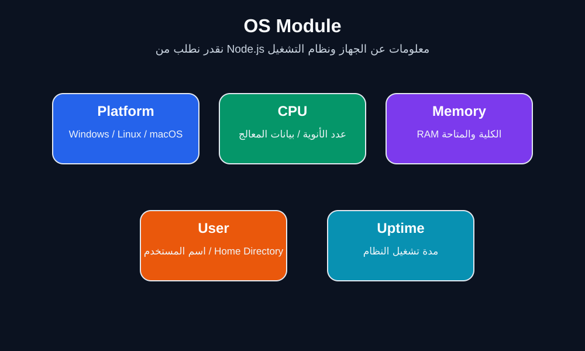
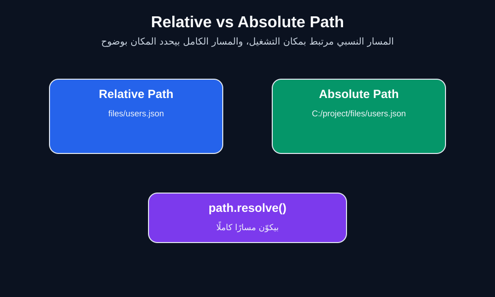

# 🟢 Node.js Backend Mastery
## Lesson 03 — Node.js Core Modules

> شرح بالمصري البسيط + أمثلة عملية + صور توضيحية + أسئلة Interview + Assignment.

---

## 📚 محتويات الدرس

- يعني إيه Module؟
- Core Modules في Node.js
- استخدام `require()`
- Path Module
  - `path.join()`
  - `path.basename()`
  - `path.dirname()`
  - `path.extname()`
  - `path.resolve()`
- OS Module
  - `os.platform()`
  - `os.arch()`
  - `os.cpus()`
  - `os.totalmem()` و `os.freemem()`
  - `os.userInfo()` و `os.homedir()`
  - `os.uptime()`
- تطبيق عملي: System Information Tool
- تطبيق Path عمليًا مع `__dirname`
- Interview Questions
- Assignment

---

# 1. يعني إيه Module؟

تخيل إننا بنعمل مشروع كبير زي E-commerce. المشروع ممكن يحتوي على تسجيل مستخدمين، Login، منتجات، طلبات، ملفات، Database، وإرسال Emails.

مش منطقي نكتب كل الوظائف دي في ملف واحد. عشان كده بنقسم البرنامج لأجزاء، كل جزء مسؤول عن وظيفة معينة.

**Module** هو جزء من الكود بنقدر ننظمه ونستخدمه في مكان تاني.

مثال على تقسيم المشروع:

```text
Application
├── Users Module
├── Authentication Module
├── Products Module
├── Orders Module
└── Payments Module
```

التقسيم ده بيساعدنا نخلي الكود منظم، أسهل في الفهم والصيانة والاختبار وإعادة الاستخدام.

---

# 2. يعني إيه Core Modules؟

Node.js بييجي مع مجموعة Modules جاهزة، بتوفر وظائف شائعة من غير ما نحتاج نثبت Packages خارجية. بنسميها:

**Built-in Modules / Core Modules**


أمثلة مهمة:

| Module | بيستخدم في إيه؟ |
|---|---|
| `fs` | قراءة وكتابة وإنشاء وحذف الملفات |
| `path` | التعامل مع مسارات الملفات والفولدرات |
| `os` | معلومات عن نظام التشغيل والجهاز |
| `http` | إنشاء HTTP Server |
| `events` | التعامل مع Events |
| `crypto` | أدوات التشفير والـ Hashing |
| `url` | التعامل مع URLs |
| `util` | Utilities وأدوات مساعدة |
| `stream` | التعامل مع البيانات على أجزاء |
| `buffer` | التعامل مع البيانات الثنائية (Binary Data) |

مش مطلوب تحفظ القائمة كلها مرة واحدة. هنستخدم كل Module في الدرس المناسب.

---

# 3. إزاي نستخدم Module؟

في CommonJS بنستخدم `require()` لتحميل Module.

```js
const os = require("os");

console.log(os.platform());
```

## نفهم الكود

```js
const os = require("os");
```

- `require()` بتطلب تحميل Module.
- `"os"` اسم الـ Module اللي عايزينه.
- `os` متغير هنستخدمه للوصول للأدوات اللي الـ Module بيقدمها.

كأننا بنقول: «يا Node، حمّل أدوات التعامل مع نظام التشغيل وخليها متاحة عندي في متغير اسمه `os`».

بعد كده:

```js
console.log(os.platform());
```

بنستدعي Function اسمها `platform()` من الـ OS Module عشان نعرف نظام التشغيل.

ممكن النتيجة تكون:

```text
win32
```

على Windows، أو `linux` على Linux، أو `darwin` على macOS.

> `require()` مش مخصوص بالـ Core Modules؛ بنستخدمه كمان مع Modules بتاعتنا ومع Packages في CommonJS.

---

# 4. Core Module vs External Package

### Core Module

بيكون موجود مع Node.js ومش محتاج تثبيت.

```js
const fs = require("fs");
```

### External Package

مكتبة خارجية غالبًا بنثبتها عن طريق npm.

```bash
npm install express
```

وبعدين في CommonJS:

```js
const express = require("express");
```

| Core Module | External Package |
|---|---|
| بييجي مع Node.js | بننزّله غالبًا من npm |
| مش محتاج Install | غالبًا محتاج Install |
| مثال: `fs`, `path`, `os` | مثال: `express`, `mongoose` |

---

# 5. Path Module — التعامل مع مسارات الملفات


في مشروعنا ممكن يكون عندنا ملف بالشكل ده:

```text
project/
├── index.js
└── files/
    └── users.json
```

لو عايزين نوصل لملف `users.json`، محتاجين نكوّن مساره.

المسارات بتختلف حسب نظام التشغيل. Windows بيستخدم غالبًا `\`، بينما Linux وmacOS بيستخدموا `/`.

بدل ما نكتب المسارات يدويًا، Node.js بيوفر لنا `path` Module.

```js
const path = require("path");
```

## 5.1 `path.join()`

بتجمع أجزاء المسار مع بعض باستخدام الفاصل المناسب لنظام التشغيل.

```js
const path = require("path");

const filePath = path.join("files", "users.json");

console.log(filePath);
```

Output على Windows:

```text
files\users.json
```

وعلى Linux/macOS:

```text
files/users.json
```

### مثال بأجزاء أكتر

```js
const path = require("path");

const filePath = path.join(
  "project",
  "data",
  "users",
  "users.json"
);

console.log(filePath);
```

`join()` بتجمع أجزاء المسار في Path واحد.

---

## 5.2 `path.basename()`

بتجيب اسم الملف من المسار.

```js
const path = require("path");

const filePath = "project/data/users/users.json";

console.log(path.basename(filePath));
```

Output:

```text
users.json
```

مثال:

```js
console.log(path.basename("C:/project/images/profile.png"));
```

Output:

```text
profile.png
```

---

## 5.3 `path.dirname()`

بتجيب اسم الفولدر أو الـ Directory اللي المسار موجود فيه.

```js
const path = require("path");

const filePath = "project/data/users/users.json";

console.log(path.dirname(filePath));
```

Output:

```text
project/data/users
```

افتكر:

- `basename()` → اسم الملف.
- `dirname()` → الفولدر الموجود فيه الملف.

---

## 5.4 `path.extname()`

بتجيب امتداد الملف.

```js
const path = require("path");

console.log(path.extname("profile.png"));
console.log(path.extname("index.js"));
console.log(path.extname("document.pdf"));
```

Output:

```text
.png
.js
.pdf
```

ممكن نستفيد منها في معرفة نوع/امتداد الملف. لكن التحقق من الامتداد وحده مش كفاية لتأمين Uploads.

---

## 5.5 `path.resolve()`

بتكوّن مسار Absolute Path، اعتمادًا على مكان تشغيل البرنامج والأجزاء اللي بنمررها.

```js
const path = require("path");

const filePath = path.resolve("files", "users.json");

console.log(filePath);
```

مثال لنتيجة ممكن تظهر:

```text
C:\projects\lesson-03\files\users.json
```

النتيجة الفعلية بتعتمد على الـ Current Working Directory.

### الفرق بين `join()` و `resolve()`

```js
path.join("files", "users.json");
```

بتجمع أجزاء المسار.

```js
path.resolve("files", "users.json");
```

بتكوّن مسارًا كاملًا (Absolute Path) من الـ Current Working Directory والأجزاء اللي اتبعتت.

**افتكرها:**

- `join` = لمّ أجزاء المسار.
- `resolve` = كوّن المسار الكامل.

---

# 6. OS Module — معلومات عن الجهاز



الـ `os` Module بيساعدنا نعرف معلومات عن Operating System والجهاز اللي البرنامج شغال عليه.

```js
const os = require("os");
```

## 6.1 `os.platform()`

```js
console.log(os.platform());
```

أمثلة على النتائج:

| النظام | Output |
|---|---|
| Windows | `win32` |
| Linux | `linux` |
| macOS | `darwin` |

## 6.2 `os.arch()`

بتعرفنا نوع الـ CPU Architecture.

```js
console.log(os.arch());
```

ممكن النتيجة:

```text
x64
```

## 6.3 `os.cpus()`

بترجع بيانات عن الـ Logical CPUs.

```js
const os = require("os");

const cpus = os.cpus();

console.log(cpus.length);
```

ممكن يطبع:

```text
8
```

يعني الـ OS رجّع بيانات عن 8 Logical CPU Cores. وده مش بالضرورة عدد الأنوية الفيزيائية.

## 6.4 `os.totalmem()` و `os.freemem()`

بيرجعوا حجم الذاكرة بالـ Bytes.

```js
const os = require("os");

console.log(os.totalmem());
console.log(os.freemem());
```

عشان نعرضها بالـ GB:

```js
const os = require("os");

const totalMemory = os.totalmem();
const freeMemory = os.freemem();

const totalGB = (totalMemory / 1024 / 1024 / 1024).toFixed(2);
const freeGB = (freeMemory / 1024 / 1024 / 1024).toFixed(2);

console.log(`Total RAM: ${totalGB} GB`);
console.log(`Free RAM: ${freeGB} GB`);
```

### ليه قسمنا على 1024 تلات مرات؟

لأننا بنحوّل من Bytes إلى KB، ثم MB، ثم GB.

```js
bytes / 1024 / 1024 / 1024
```

## 6.5 `os.userInfo()`

بتجيب بيانات عن المستخدم الحالي.

```js
const os = require("os");

console.log(os.userInfo().username);
```

ممكن تطبع اسم حساب المستخدم على الجهاز.

## 6.6 `os.homedir()`

بتجيب الـ Home Directory الخاص بالمستخدم الحالي.

```js
const os = require("os");

console.log(os.homedir());
```

مثال Output على Windows:

```text
C:\Users\Mohamed
```

## 6.7 `os.uptime()`

بتجيب مدة تشغيل نظام التشغيل بالثواني.

```js
const os = require("os");

const seconds = os.uptime();

console.log(seconds);
```

تحويلها لساعات:

```js
const os = require("os");

const uptimeInSeconds = os.uptime();
const uptimeHours = (uptimeInSeconds / 3600).toFixed(2);

console.log(`System uptime: ${uptimeHours} hours`);
```

---

# 7. Practical Project — System Information Tool

هنجمع المعلومات اللي اتعلمناها في برنامج واحد.

اعمل ملف `system-info.js`:

```js
const os = require("os");

console.log("==============================");
console.log("       SYSTEM INFORMATION");
console.log("==============================");

console.log(`Operating System: ${os.platform()}`);
console.log(`Architecture: ${os.arch()}`);
console.log(`Username: ${os.userInfo().username}`);
console.log(`Home Directory: ${os.homedir()}`);
console.log(`CPU Cores: ${os.cpus().length}`);

const totalMemory = (os.totalmem() / 1024 ** 3).toFixed(2);
const freeMemory = (os.freemem() / 1024 ** 3).toFixed(2);

console.log(`Total RAM: ${totalMemory} GB`);
console.log(`Free RAM: ${freeMemory} GB`);

const uptime = (os.uptime() / 3600).toFixed(2);

console.log(`System Uptime: ${uptime} hours`);

console.log("==============================");
```

شغّله:

```bash
node system-info.js
```

مثال Output (الأرقام هتختلف حسب جهازك):

```text
==============================
       SYSTEM INFORMATION
==============================
Operating System: win32
Architecture: x64
Username: Mohamed
Home Directory: C:\Users\Mohamed
CPU Cores: 8
Total RAM: 15.78 GB
Free RAM: 4.21 GB
System Uptime: 12.45 hours
==============================
```

## إحنا عملنا إيه؟

استخدمنا `os` Module بدل ما نكتب كود من الصفر عشان نعرف:

- Operating System.
- Architecture.
- Username.
- Home Directory.
- CPU Cores.
- Total RAM & Free RAM.
- System Uptime.

---

# 8. Path عملي مع `__dirname`

لو عندنا Structure:

```text
lesson-03/
├── index.js
└── files/
    └── users.json
```

في `index.js`:

```js
const path = require("path");

const filePath = path.join(__dirname, "files", "users.json");

console.log(filePath);
```

## يعني إيه `__dirname`؟

في CommonJS، `__dirname` بتحتوي على Absolute Path للفولدر اللي الملف الحالي موجود فيه.

لو `index.js` موجود هنا:

```text
C:\projects\lesson-03
```

فـ:

```js
console.log(__dirname);
```

هتطبع المسار ده.

ولما نكتب:

```js
path.join(__dirname, "files", "users.json");
```

بنقول:

> ابدأ من فولدر الملف الحالي، ادخل `files`، وبعدها هات `users.json`.



### ملحوظة

`__dirname` و`__filename` متاحين في CommonJS. في ES Modules بنستخدم طريقة مختلفة للحصول على مسار الملف الحالي، وهنشرح ده لما ندرس Module Systems.

---

# 9. استخدام Modules مع بعض

ممكن نستخدم أكتر من Core Module في نفس العملية.

```js
const path = require("path");
const os = require("os");

const userFolder = os.homedir();

const downloadsPath = path.join(userFolder, "Downloads");

console.log(downloadsPath);
```

هنا:

- `os.homedir()` جابت Home Directory.
- `path.join()` جمعت المسار مع `Downloads`.
- النتيجة مسار مناسب لنظام التشغيل.

وده طبيعي جدًا في مشاريع Backend؛ الـ Modules بتتكامل مع بعض.

---

# 10. ملخص أهم Functions

| Function | وظيفتها |
|---|---|
| `path.join()` | تجميع أجزاء المسار |
| `path.resolve()` | تكوين Absolute Path |
| `path.basename()` | اسم الملف |
| `path.dirname()` | اسم الفولدر |
| `path.extname()` | امتداد الملف |
| `os.platform()` | نظام التشغيل |
| `os.arch()` | Architecture |
| `os.cpus()` | بيانات الـ CPUs |
| `os.totalmem()` | RAM الكلية بالـ Bytes |
| `os.freemem()` | RAM المتاحة بالـ Bytes |
| `os.homedir()` | Home Directory |
| `os.userInfo()` | معلومات المستخدم |
| `os.uptime()` | مدة تشغيل النظام بالثواني |

---

# 11. Interview Questions 🎯

### Q1: What are Node.js Core Modules?

Core Modules are built-in modules provided by Node.js that let developers perform common operations without installing external packages.

### Q2: What is the purpose of the Path Module?

It provides utilities for handling file and directory paths.

### Q3: What is the difference between `path.join()` and `path.resolve()`?

- `join()` combines path segments.
- `resolve()` creates an absolute path based on the current working directory and the supplied segments.

### Q4: What is `__dirname`?

In CommonJS, it represents the absolute path of the directory containing the current file.

### Q5: What is the OS Module?

It provides information and utilities related to the operating system.

### Q6: Do we need to install Core Modules?

No. They are included with Node.js.

### Q7: What is the difference between Core Modules and npm Packages?

Core Modules are built into Node.js. npm Packages are external libraries that we typically install and use in our applications.

### Q8: How can we get the number of logical CPUs?

```js
require("os").cpus().length;
```

### Q9: How can we get the file extension?

```js
require("path").extname("photo.png");
```

### Q10: What does `os.homedir()` return?

It returns the home directory of the current user.

---

# 12. Assignment 💪

## Task 1 — `index.js`

اطبع:

- Operating System.
- Architecture.
- Username.
- Number of CPU Cores.

## Task 2 — `path-practice.js`

اعمل مسار:

```text
data/users/profile.json
```

واستخدم:

- `path.join()`
- `path.basename()`
- `path.dirname()`
- `path.extname()`
- `path.resolve()`

اطبع نتيجة كل Function.

## Task 3 — `system-info.js`

اعمل System Information Tool يطبع:

- Total RAM.
- Free RAM.
- OS Platform.
- CPU Cores.
- System Uptime.
- Home Directory.

وخلي شكل الـ Output منظم.

---

# 13. Quick Quiz — اختبر نفسك

حاول تجاوب قبل ما ترجع للشرح:

1. إيه الفرق بين Module وPackage؟
2. ليه بنستخدم `require()`؟
3. `path.join()` وظيفتها إيه؟
4. إيه الفرق بين `basename()` و`dirname()`؟
5. إيه الفرق بين Absolute Path وRelative Path؟
6. ليه استخدام `path.join()` مفيد بدل كتابة المسار يدويًا؟
7. إزاي نعرف عدد الـ CPU Cores؟
8. هل `fs` محتاج تثبيت؟
9. إيه وظيفة `os.homedir()`؟
10. لو عايز تجيب امتداد `photo.png`، تستخدم إيه؟

---

# 🧠 أهم فكرة تخرج بيها من الدرس

Node.js بيوفر Tools جاهزة اسمها Core Modules، وكل Module بيخدم غرض معين.

بدل ما نكتب كل حاجة من الصفر، بنتعلم نستخدم الأدوات اللي Node بيوفرها لنا.

النهارده اتعرفنا على `path` و`os`، وفي الدرس القادم هنبدأ نتعامل مع الملفات فعليًا باستخدام `fs`.

---

# ⏭️ Next Lesson

## Lesson 04 — File System (fs)

هنبدأ نتعلم:

- قراءة الملفات.
- كتابة الملفات.
- إنشاء ملفات وفولدرات.
- حذف الملفات.
- التعامل مع JSON.
- الفرق بين Sync وAsync.
- Callbacks.
- Promises.
- `fs/promises`.
- تطبيقات عملية.

---

> **Study Tip:** متحاولش تحفظ كل Functions. افتح VS Code، جرّب كل مثال، غيّر القيم، وشوف النتيجة. الهدف إنك تفهم وتقدر تستخدم الـ Module لما تحتاجه.
