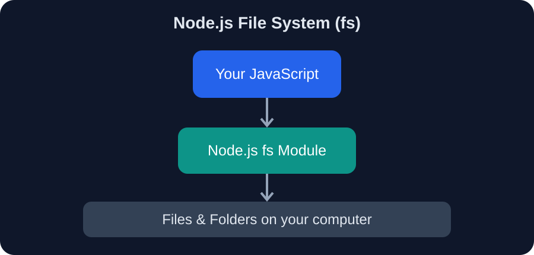
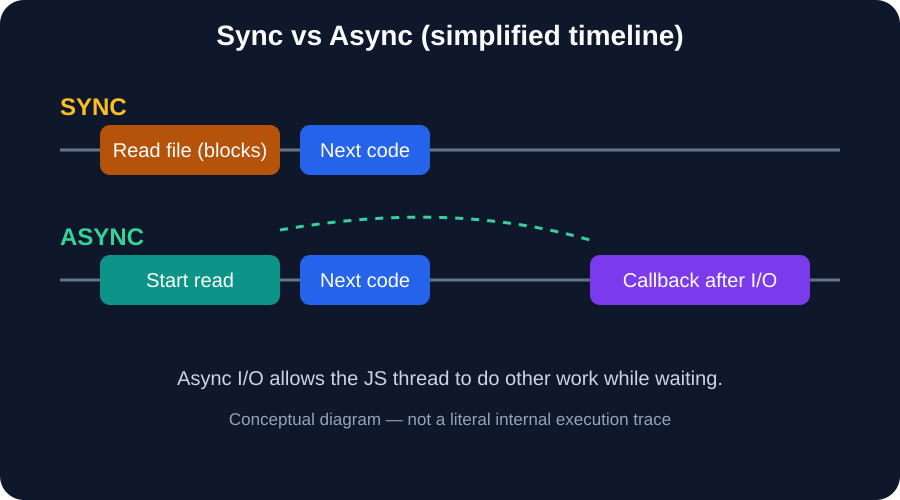
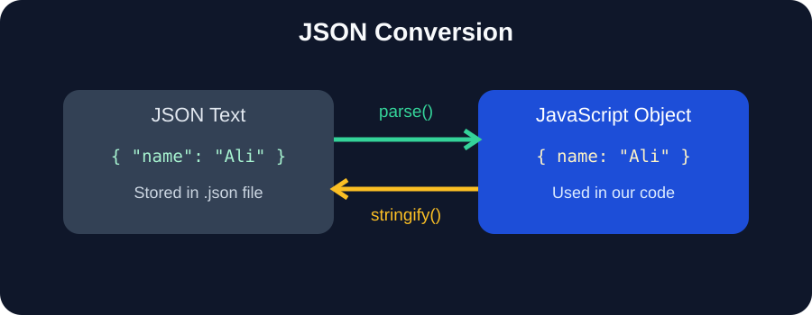
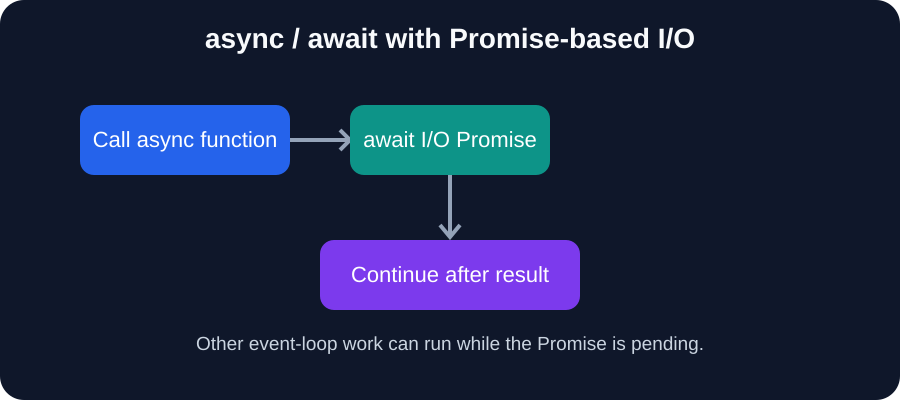
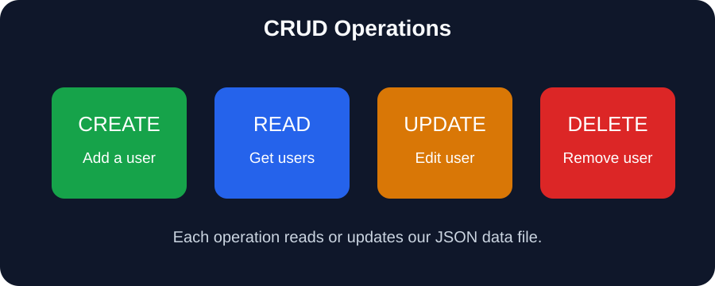

# 🚀 Lesson 04 — File System (FS) Module

> **Node.js Backend Mastery | شرح عملي بالمصري 🇪🇬**

في المحاضرة دي هنتعلم إزاي Node.js يقدر يتعامل مع الملفات والفولدرات على جهازنا:
- قراءة الملفات (Read)
- إنشاء وكتابة الملفات (Create / Write)
- إضافة محتوى من غير مسح القديم (Append)
- حذف وإعادة تسمية الملفات (Delete / Rename)
- إنشاء فولدرات والتعامل معاها
- قراءة وكتابة JSON
- تنفيذ العمليات بشكل Sync أو Async
- استخدام `async/await` مع `fs/promises`
- تطبيق CRUD بسيط على ملف JSON

---

## 📚 Table of Contents
1. [يعني إيه File System؟](#-يعني-إيه-file-system)
2. [استدعاء fs](#-استدعاء-fs)
3. [قراءة الملفات](#-قراءة-الملفات)
4. [Sync vs Async](#-sync-vs-async)
5. [كتابة الملفات](#-كتابة-الملفات)
6. [Append](#-append)
7. [Delete & Rename](#-delete--rename)
8. [Folders](#-folders)
9. [JSON](#-json)
10. [fs/promises و async/await](#-fspromises-و-asyncawait)
11. [دوال مفيدة إضافية](#-دوال-مفيدة-إضافية)
12. [Mini Project: JSON Users CRUD](#-mini-project-json-users-crud)
13. [Interview Questions](#-interview-questions)
14. [Assignment](#-assignment)

---

## 🗂️ يعني إيه File System؟

الـ **File System** هو الطريقة اللي نظام التشغيل بينظم بيها الملفات والفولدرات، وNode.js بيدينا Module اسمه `fs` عشان نقدر نتعامل معاهم من JavaScript.

يعني بدل ما تفتح ملف بإيدك وتكتب فيه، تقدر تعمل ده بالكود.



### استخدامات عملية
- قراءة Config files.
- إنشاء Logs.
- التعامل مع ملفات JSON.
- رفع الملفات ومعالجتها (مع أدوات مناسبة).
- إنشاء تقارير أو ملفات output.

---

## 1️⃣ استدعاء fs

الـ `fs` من **Core Modules**، يعني موجود مع Node.js ومش محتاج تثبيت من npm.

```js
const fs = require("fs");
```

> في CommonJS بنستخدم `require`. لو مشروعك ES Modules ممكن تستخدم `import`.

---

## 2️⃣ قراءة الملفات

خلينا نعمل structure:

```text
lesson-04-fs/
├── index.js
└── files/
    └── message.txt
```

محتوى `message.txt`:

```text
Hello from Node.js!
```

### `readFileSync()` — قراءة متزامنة

```js
const fs = require("fs");

const data = fs.readFileSync("./files/message.txt");
console.log(data);
```

ممكن تلاقي الناتج Buffer بدل نص واضح. الـ **Buffer** بيخزن البيانات في صورة bytes.

لو عايز نص:

```js
const data = fs.readFileSync("./files/message.txt", "utf8");
console.log(data);
```

أو:

```js
const data = fs.readFileSync("./files/message.txt", {
  encoding: "utf8",
});
```

---

## 3️⃣ Sync vs Async

### Synchronous (Sync)
العملية بتوقف تنفيذ الكود الحالي لحد ما تخلص. في Node.js، استخدام Sync في مسار التعامل مع الطلبات ممكن يعطل الـ Event Loop.

```js
const fs = require("fs");

console.log("1");

const data = fs.readFileSync("./files/message.txt", "utf8");
console.log(data);

console.log("2");
```

الترتيب: `1` → محتوى الملف → `2`.

### Asynchronous (Async)
بتطلب العملية، والكود يكمل تنفيذ باقي الخطوات، ولما العملية تخلص الـ callback بيتنفذ.

```js
const fs = require("fs");

console.log("1");

fs.readFile("./files/message.txt", "utf8", (err, data) => {
  if (err) {
    console.log("Error:", err.message);
    return;
  }

  console.log(data);
});

console.log("2");
```

الترتيب المتوقع: `1` → `2` → محتوى الملف.



> **مهم:** Async مش معناها إن JavaScript نفسها بتنفذ كودين JS في نفس اللحظة. عملية الـ I/O بيتم التعامل معاها بواسطة نظام التشغيل/آليات Node، وبعد ما تخلص بيتحدد callback للتنفيذ على الـ JavaScript thread.

### Error-first Callback
في Node.js غالبًا أول parameter في callback بيكون `err`:

```js
fs.readFile("./files/missing.txt", "utf8", (err, data) => {
  if (err) {
    console.error(err.message);
    return;
  }

  console.log(data);
});
```

---

## 4️⃣ كتابة الملفات — Write

`writeFile` بيكتب في ملف. لو الملف موجود، بيستبدل محتواه افتراضيًا؛ ولو مش موجود، غالبًا بيعمله.

### Sync

```js
fs.writeFileSync("./files/output.txt", "Created by Node.js");
```

### Async

```js
fs.writeFile("./files/output.txt", "Hello!", (err) => {
  if (err) {
    console.error(err.message);
    return;
  }

  console.log("File written successfully");
});
```

---

## 5️⃣ إضافة محتوى — Append

`appendFile` بيضيف المحتوى في نهاية الملف بدل ما يستبدل الموجود.

```js
fs.appendFileSync("./files/output.txt", "\nNew line added!");
```

Async:

```js
fs.appendFile("./files/output.txt", "\nAnother line", (err) => {
  if (err) return console.error(err.message);
  console.log("Content appended");
});
```

---

## 6️⃣ Delete & Rename

### حذف ملف — `unlink`

```js
fs.unlink("./files/output.txt", (err) => {
  if (err) return console.error(err.message);
  console.log("File deleted");
});
```

الـ Sync:

```js
fs.unlinkSync("./files/output.txt");
```

### إعادة تسمية أو نقل ملف — `rename`

```js
fs.rename("./files/message.txt", "./files/new-message.txt", (err) => {
  if (err) return console.error(err.message);
  console.log("File renamed");
});
```

> `rename` ممكن يستخدم لنقل ملف لمسار آخر، بشرط المسار المستهدف يكون مناسب وموجود حسب العملية ونظام التشغيل.

---

## 7️⃣ التعامل مع Folders

### إنشاء فولدر

```js
fs.mkdir("./uploads", (err) => {
  if (err) return console.error(err.message);
  console.log("Folder created");
});
```

إنشاء nested folders:

```js
fs.mkdir("./data/users/profile", { recursive: true }, (err) => {
  if (err) return console.error(err.message);
  console.log("Folders created");
});
```

### قراءة محتويات فولدر — `readdir`

```js
fs.readdir("./files", (err, files) => {
  if (err) return console.error(err.message);
  console.log(files);
});
```

---

## 8️⃣ JSON مع Node.js

JSON صيغة شائعة لتبادل وتخزين البيانات. الملف `users.json`:

```json
[
  {
    "id": 1,
    "name": "Mohamed",
    "email": "mohamed@example.com"
  }
]
```

### قراءة JSON

الملف بيتقري كنص، وبعدين نحوله لـ JavaScript value:

```js
const rawData = fs.readFileSync("./data/users.json", "utf8");
const users = JSON.parse(rawData);

console.log(users);
```

### تحويل Object إلى JSON

```js
const user = {
  id: 2,
  name: "Ali",
  email: "ali@example.com",
};

const jsonText = JSON.stringify(user, null, 2);
console.log(jsonText);
```

- `JSON.parse()` : JSON text → JavaScript object/array.
- `JSON.stringify()` : JavaScript object/array → JSON text.
- `null, 2` لتنسيق الملف بمسافات وindentation.



---

## 9️⃣ fs/promises و async/await

بدل callback style، نقدر نستخدم Promise API:

```js
const fs = require("fs/promises");
```

مثال بـ `async/await`:

```js
const fs = require("fs/promises");

async function readMessage() {
  try {
    const data = await fs.readFile("./files/message.txt", "utf8");
    console.log(data);
  } catch (err) {
    console.error("Reading failed:", err.message);
  }
}

readMessage();
```

### الفكرة
- `async` بتخلي الدالة ترجع Promise.
- `await` بتستنى نتيجة الـ Promise داخل الدالة async.
- أثناء انتظار I/O، الـ Event Loop يقدر يتعامل مع شغل تاني؛ مش بنقفل البرنامج كله.
- `try/catch` للتعامل مع errors.



### كتابة ملف بالـ Promise API

```js
const fs = require("fs/promises");

async function saveFile() {
  try {
    await fs.writeFile("./files/output.txt", "Saved using Promise API");
    console.log("Saved");
  } catch (err) {
    console.error(err.message);
  }
}

saveFile();
```

---

## 🔟 دوال مفيدة إضافية

### `stat()` — معلومات عن ملف أو فولدر

```js
const stats = fs.statSync("./files/message.txt");

console.log(stats.size);      // الحجم بالـ bytes
console.log(stats.isFile()); // هل ملف؟
console.log(stats.isDirectory()); // هل فولدر؟
```

Promise version:

```js
const stats = await fs.stat("./files/message.txt");
```

### `access()` — اختبار صلاحية/وجود

```js
try {
  await fs.access("./files/message.txt");
  console.log("Can access file");
} catch {
  console.log("Not accessible");
}
```

> ملاحظة: تجنب الاعتماد على `access()` كخطوة منفصلة قبل العملية الأساسية في تطبيقات متزامنة؛ ممكن حالة الملف تتغير بين الفحص والتنفيذ. الأفضل تنفذ العملية المطلوبة وتتعامل مع الخطأ.

---

## 1️⃣1️⃣ Mini Project — Users CRUD using JSON

هنعمل إدارة Users بسيطة من ملف JSON. ده تدريب على CRUD، مش بديل Database في تطبيق Production.

### Project Structure

```text
users-crud/
├── index.js
└── data/
    └── users.json
```

`data/users.json`:

```json
[]
```

### الكود الكامل — `index.js`

```js
const fs = require("fs/promises");
const path = require("path");

const usersFile = path.join(__dirname, "data", "users.json");

async function getUsers() {
  try {
    const data = await fs.readFile(usersFile, "utf8");
    return JSON.parse(data);
  } catch (err) {
    if (err.code === "ENOENT") {
      // لو الملف مش موجود، نبدأ بقائمة فاضية
      return [];
    }

    throw err;
  }
}

async function saveUsers(users) {
  const data = JSON.stringify(users, null, 2);
  await fs.writeFile(usersFile, data);
}

async function addUser(name, email) {
  const users = await getUsers();

  const newUser = {
    id: Date.now(), // للتدريب فقط؛ استخدم ID strategy مناسبة في التطبيقات الحقيقية
    name,
    email,
  };

  users.push(newUser);
  await saveUsers(users);

  console.log("User added:", newUser);
  return newUser;
}

async function updateUser(id, newName) {
  const users = await getUsers();
  const user = users.find((user) => user.id === id);

  if (!user) {
    console.log("User not found");
    return;
  }

  user.name = newName;
  await saveUsers(users);
  console.log("User updated:", user);
}

async function deleteUser(id) {
  const users = await getUsers();
  const updatedUsers = users.filter((user) => user.id !== id);

  if (updatedUsers.length === users.length) {
    console.log("User not found");
    return;
  }

  await saveUsers(updatedUsers);
  console.log("User deleted");
}

async function displayUsers() {
  const users = await getUsers();
  console.log("All users:", users);
}

async function main() {
  try {
    await addUser("Mohamed", "mohamed@example.com");
    await addUser("Ali", "ali@example.com");
    await displayUsers();

    // جرّب updateUser(id, "New Name") و deleteUser(id)
    // استخدم ID موجود من الملف.
  } catch (err) {
    console.error("Something went wrong:", err.message);
  }
}

main();
```

### CRUD يعني إيه؟

| العملية | معناها | في مثالنا |
|---|---|---|
| Create | إنشاء | `addUser()` |
| Read | قراءة | `getUsers()` / `displayUsers()` |
| Update | تعديل | `updateUser()` |
| Delete | حذف | `deleteUser()` |



### تشغيل المشروع

من داخل فولدر المشروع:

```bash
node index.js
```

### تنبيه مهم
التعامل مع JSON file مناسب للتدريب أو أدوات صغيرة. في تطبيق ويب حقيقي، مع requests متزامنة، ممكن تحصل مشاكل lost updates أو فساد/تعارض بيانات. استخدم Database مناسبة، وعمليات كتابة آمنة حسب الحاجة.

---

## 🎯 Interview Questions

### 1. What is the FS module?
Module built into Node.js that allows interacting with files and directories.

### 2. Difference between `readFile` and `readFileSync`?
`readFile` asynchronous callback-based; `readFileSync` blocks execution until the operation completes.

### 3. What is a Buffer?
A way to represent binary data as bytes in Node.js.

### 4. Why specify `utf8`?
To decode bytes into a readable text string.

### 5. Difference between `writeFile` and `appendFile`?
`writeFile` replaces file contents by default; `appendFile` adds data at the end.

### 6. What is error-first callback style?
Callback arguments conventionally begin with an error argument, followed by result data.

### 7. What is `fs/promises`?
Promise-based APIs for filesystem operations, usable with `.then()` or `async/await`.

### 8. Does `await` block all of Node.js?
No. It suspends the async function's continuation while the Promise is pending; other event-loop work can proceed.

### 9. `JSON.parse` vs `JSON.stringify`?
Parse converts JSON text to a JS value; stringify converts a JS value to JSON text.

### 10. Why avoid Sync FS methods in a server?
They block the JavaScript thread, preventing it from handling other work while the operation is in progress.

---

## 📝 Assignment

### Part 1 — Basic File Operations
1. Create a project named `file-system-practice`.
2. Create `files/message.txt` and put a short message inside.
3. Read and print the file using `readFile`.
4. Create `output.txt` using `writeFile`.
5. Add a new line using `appendFile`.
6. Rename `output.txt` to `final.txt`.
7. Delete a separate test file using `unlink`.

### Part 2 — JSON Practice
Create `data/products.json` with at least 3 products:
- `id`
- `name`
- `price`

Write functions to:
- Read all products.
- Add a product.
- Find a product by ID.
- Update its price.
- Delete a product by ID.
- Save the updated array back to JSON.

### Part 3 — Async/Await
Use `require("fs/promises")`, `async/await`, and `try/catch` for your operations.

### Part 4 — Explain in your own words
1. Why is async file handling useful in Node.js?
2. What happens if we use `readFileSync` during handling of a server request?
3. What is the difference between JSON and a JavaScript object?
4. Why is JSON-file CRUD not ideal for a production database?

> ابعتلي الحل بعد ما تخلص، وأنا أراجعه معاك خطوة خطوة وأشرحلك أي غلط من غير ما أحل مكانك 💪

---

## ✅ Lesson Checklist

- [ ] Understand `fs`
- [ ] Read a file
- [ ] Understand Buffer and UTF-8
- [ ] Compare Sync and Async
- [ ] Write and append
- [ ] Delete and rename
- [ ] Create/read folders
- [ ] Parse and stringify JSON
- [ ] Use `fs/promises`
- [ ] Practice async/await and try/catch
- [ ] Complete JSON CRUD assignment

---

## 🧭 Course Roadmap

| Lesson | Topic | Status |
|---|---|---|
| 01 | Introduction to Backend & Node.js | ✅ |
| 02 | Node.js Architecture & Event Loop | ✅ |
| 03 | Core Modules (`path`, `os`) | ✅ |
| 04 | File System (`fs`) | ✅ |
| 05 | Events & EventEmitter | ⏭️ Next |
| 06 | Buffers | ⏳ |
| 07 | Streams | ⏳ |
| 08 | HTTP Module & Web Server | ⏳ |
| 09 | NPM & Package Management | ⏳ |
| 10 | Environment Variables & Configuration | ⏳ |
| 11 | Express.js | ⏳ |
| 12+ | REST APIs, Databases, Authentication, Security | ⏳ |

---

⭐ If you're learning from this repository, follow along with the lessons and try every example yourself.

**Made for learning — Node.js Backend Mastery**
