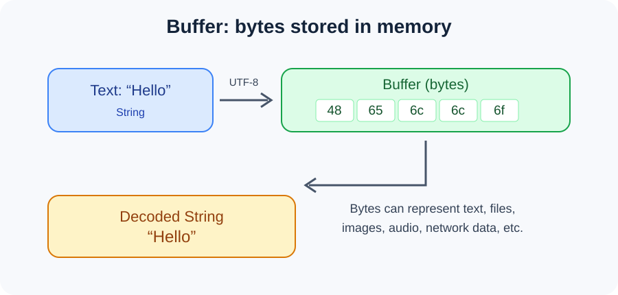
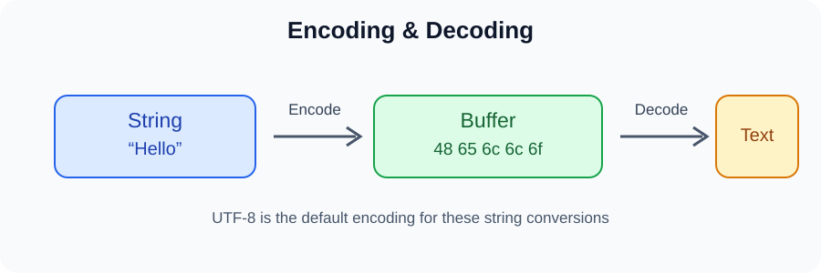
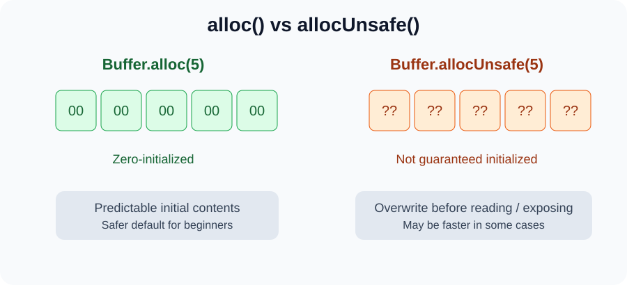

# Lesson 06 — Buffers in Node.js

> شرح بالمصري + مصطلحات إنجليزي + أمثلة عملية + رسومات + أسئلة وتاسك.

## محتويات الدرس
1. What is a Buffer?
2. Bits, Bytes, Binary & Hexadecimal
3. Encoding and Decoding
4. `Buffer.from()`
5. `buffer.length`
6. `buffer.toString()`
7. `Buffer.alloc()`
8. Writing to a Buffer: `buffer[index]`, `buffer.write()`, `buffer.fill()`
9. `Buffer.allocUnsafe()` — السرعة والأمان
10. مقارنة `from`, `alloc`, `allocUnsafe`
11. Interview Questions
12. Assignment

---

## 1) يعني إيه Buffer؟



الـ **Buffer** مساحة في الذاكرة بتخزن بيانات خام على هيئة **Bytes**. Node.js بيستخدمه للتعامل مع البيانات الثنائية (Binary Data)، زي الملفات والصور والصوت والفيديو والبيانات اللي بتوصل من الشبكة.

الكمبيوتر في مستوى منخفض بيتعامل مع Bits (0 و1)، وعلشان نمثل البيانات بنستخدم Bytes. الـ Buffer بيساعدنا نتعامل مع مجموعة Bytes داخل Node.js.


### أمثلة على بيانات ممكن نحتاج Buffer معاها
- Images وVideos وAudio
- PDF وملفات مختلفة
- Network data
- بيانات بنقرأها من Files أو Streams

> الـ Buffer مش مخصوص للصور فقط؛ حتى النص ممكن نحوله إلى Bytes ونخزنه في Buffer.

---

## 2) Bits, Bytes, Binary, Decimal & Hexadecimal

- **Bit:** أصغر وحدة، قيمتها 0 أو 1.
- **Byte:** 8 Bits.
- **Binary:** تمثيل بالأرقام 0 و1.
- **Decimal:** النظام العشري (0 إلى 9).
- **Hexadecimal:** النظام الست عشري (0 إلى 9 وA إلى F)، طريقة مختصرة شائعة لعرض Bytes.

مثال حرف `H` في UTF-8:

| التمثيل | القيمة |
|---|---|
| Character | `H` |
| Decimal | `72` |
| Binary | `01001000` |
| Hexadecimal | `48` |

`48` هنا Hexadecimal، وقيمته بالعشري `72`.

---

## 3) Encoding & Decoding



**Encoding** هو تحويل نص إلى Bytes حسب Encoding معين (زي UTF-8).

**Decoding** هو تفسير Bytes وإرجاعها لنص حسب Encoding مناسب.

```text
String ── Encoding (UTF-8) ──> Bytes / Buffer
String <── Decoding (UTF-8) ── Bytes / Buffer
```

Node.js بيستخدم UTF-8 افتراضيًا في `Buffer.from(string)` و`buffer.toString()`.

> مش كل Buffer بيكون ASCII. ASCII جزء محدود من الترميزات، بينما UTF-8 بيدعم لغات كتير، ومنها العربي.

---

## 4) إنشاء Buffer باستخدام `Buffer.from()`

لو البيانات موجودة بالفعل وعايز تحولها إلى Buffer:

```js
const buffer = Buffer.from("Hello");

console.log(buffer);
console.log(buffer.length);
console.log(buffer.toString());
```

Output (شكل عرض Hex):

```text
<Buffer 48 65 6c 6c 6f>
5
Hello
```

القيم دي Bytes بتظهر في الـ Console بالـ Hexadecimal.

### تحويل Array من أرقام

```js
const buffer = Buffer.from([72, 101, 108, 108, 111]);

console.log(buffer);
console.log(buffer.toString()); // Hello
```

الأرقام هنا قيم Bytes بالعشري. كل رقم بيتحول لByte، والـ UTF-8/ASCII-compatible values دي بتطلع النص `Hello`.

### مثال: ASCII-compatible characters

```js
const buffer = Buffer.from([65, 66, 67, 68]);

console.log(buffer.toString()); // ABCD
```

---

## 5) `buffer.length`

`length` بترجع عدد الـ Bytes في Buffer، مش بالضرورة عدد الحروف.

```js
const buffer = Buffer.from("Hello");
console.log(buffer.length); // 5
```

مع العربي، الحروف في UTF-8 غالبًا بتحتاج أكتر من Byte:

```js
const buffer = Buffer.from("محمد");

console.log(buffer.length); // عدد Bytes، مش عدد الحروف
console.log(buffer.toString()); // محمد
```

---

## 6) `buffer.toString()`

بتفك الـ Bytes إلى String باستخدام UTF-8 افتراضيًا:

```js
const buffer = Buffer.from("Node.js Backend");
const text = buffer.toString();

console.log(text); // Node.js Backend
```

تقدر تحدد Encoding (لما يكون مناسب للبيانات):

```js
buffer.toString("utf8");
```

---

## 7) `Buffer.alloc()` — تخصيص Buffer آمن

`Buffer.alloc(size)` بتنشيء Buffer بالحجم المحدد وبتملأ Bytes بأصفار.

```js
const buffer = Buffer.alloc(5);

console.log(buffer);        // <Buffer 00 00 00 00 00>
console.log(buffer.length); // 5
```

`alloc` من Allocation، يعني تخصيص مساحة.

### كتابة Bytes باستخدام Index

```js
const buffer = Buffer.alloc(5);

buffer[0] = 72;
buffer[1] = 101;
buffer[2] = 108;
buffer[3] = 108;
buffer[4] = 111;

console.log(buffer.toString()); // Hello
```

الـ Index بيبدأ من صفر.

### `buffer.write()`

```js
const buffer = Buffer.alloc(5);

buffer.write("Hello");

console.log(buffer);        // <Buffer 48 65 6c 6c 6f>
console.log(buffer.toString()); // Hello
```

### مساحة أكبر من النص

```js
const buffer = Buffer.alloc(10);

buffer.write("Node.js");

console.log(buffer.toString()); // Node.js مع trailing null bytes
console.log(buffer);           // الباقي أصفار
console.log(buffer.length);    // 10
```

`toString()` عادةً بيعرض الأصفار المتبقية كـ null characters، ومش هتشوفها كحروف ظاهرة. استخدم `buffer.subarray(0, bytesWritten)` لو عايز النص المكتوب فقط.

مثال أدق:

```js
const buffer = Buffer.alloc(10);
const bytesWritten = buffer.write("Node.js");

console.log(buffer.subarray(0, bytesWritten).toString()); // Node.js
```

### لو المساحة أصغر من النص

```js
const buffer = Buffer.alloc(4);
const bytesWritten = buffer.write("Hello");

console.log(bytesWritten); // 4
console.log(buffer.toString()); // Hell
```

المتاح 4 Bytes فقط، فمش كل النص اتكتب.

### `buffer.fill()`

بتملأ كل Buffer بقيمة:

```js
const buffer = Buffer.alloc(4);
buffer.fill("A");

console.log(buffer);        // <Buffer 41 41 41 41>
console.log(buffer.toString()); // AAAA
```

---

## 8) `Buffer.allocUnsafe()` — الأداء والحذر



```js
const buffer = Buffer.allocUnsafe(5);
console.log(buffer);
```

بتحجز مساحة، لكن **مش بتضمن إن المحتوى يتصفّر**. القيم الموجودة غير مهيأة/غير مضمونة؛ ممكن تكون أصفار أو قيم أخرى، وممنوع تعتمد عليها.

ليه اسمها Unsafe؟
- لو قرأت أو أرسلت محتوى قبل ما تكتب عليه، ممكن تتعامل مع بيانات غير متوقعة.
- في بعض الاستخدامات الخاطئة، ده ممكن يسبب كشف بيانات قديمة من الذاكرة.
- قد تكون أسرع لأنها لا تصفّر الذاكرة عند التخصيص.

### الاستخدام الصحيح

استخدم `allocUnsafe` فقط لو هتكتب كل Bytes اللي هتستخدمها قبل قراءتها أو إرسالها.

```js
const buffer = Buffer.allocUnsafe(5);
buffer.write("Hello");

console.log(buffer.toString()); // Hello
```

ده مناسب لأننا كتبنا الخمس Bytes قبل استخدامها.

لو كتبت أقل من الحجم، لازم تقصر الجزء اللي هتستخدمه على البيانات المكتوبة، أو تضمن تهيئة الباقي:

```js
const buffer = Buffer.allocUnsafe(10);
const bytesWritten = buffer.write("Node");

console.log(buffer.subarray(0, bytesWritten).toString()); // Node
```

`Buffer.allocUnsafe(10)` مع `write("Node")` مش معناه إن باقي 6 Bytes اتصفّروا. ما تقرأش أو تبعت الجزء غير المكتوب.

> للمبتدئ ومعظم الاستخدامات، استخدم `Buffer.alloc()`؛ الوضوح والأمان أهم من فرق أداء غير مؤكد.

---

## 9) مقارنة الطرق

| Method | إمتى نستخدمها؟ | النتيجة |
|---|---|---|
| `Buffer.from(data)` | البيانات موجودة وعايز Buffer منها | Buffer بمحتوى البيانات |
| `Buffer.alloc(size)` | محتاج Buffer جديد بحجم معين | Bytes مبدئيًا صفر |
| `Buffer.allocUnsafe(size)` | تخصيص ممكن يكون أسرع، مع ضمان تهيئة كل الجزء المستخدم | المحتوى غير مضمون قبل الكتابة |

---

## 10) أمثلة التشغيل

شغّل أي ملف من داخل فولدر الدرس:

```bash
node examples/01-buffer-from.js
```

ملفات الأمثلة:
- `01-buffer-from.js`
- `02-buffer-alloc.js`
- `03-buffer-write.js`
- `04-buffer-alloc-unsafe.js`

---

## 11) Interview Questions

### Q1: What is a Buffer in Node.js?
A Buffer is a built-in type used to work with raw binary data (bytes) in memory.

### Q2: What is a Byte?
A Byte consists of 8 bits.

### Q3: What is Encoding?
Encoding converts data (such as text) into bytes using a character encoding scheme.

### Q4: What does `Buffer.from()` do?
It creates a Buffer from existing data, such as a string or an array of byte values.

### Q5: What does `Buffer.alloc()` do?
It creates a Buffer of a specified size and initializes it with zeros by default.

### Q6: What is the difference between `alloc()` and `allocUnsafe()`?
`alloc()` initializes the allocated memory to zeros. `allocUnsafe()` does not guarantee initialization and may be faster, so the used bytes must be overwritten before reading or exposing them.

### Q7: Does `buffer.length` return characters?
No. It returns the number of bytes in the Buffer.

### Q8: What does `toString()` do?
It decodes Buffer bytes into a string using UTF-8 by default.

### Q9: Is every Buffer ASCII?
No. Buffer stores bytes. ASCII is one character encoding; Node.js commonly uses UTF-8 for text conversions.

---

## 12) Assignment 🧠💻

### Task 1 — From String
Create a Buffer from `"Backend"` and print:
- Buffer representation
- Length
- Decoded string

### Task 2 — From Numbers
Create a Buffer from `[65, 66, 67, 68]` and predict/print the decoded result.

### Task 3 — Allocate & Write
1. Allocate 8 Bytes.
2. Write `"Node.js"`.
3. Print the length.
4. Print only the written text using the return value of `write()` and `subarray()`.

### Task 4 — Fill
Create a Buffer of 4 Bytes, fill it with `"A"`, then print the Buffer and string.

### Task 5 — Safe vs Unsafe
In your own words, explain why `allocUnsafe()` requires care. Write an example where you only read the bytes you wrote.

### Challenge
What will this print?

```js
const buffer = Buffer.alloc(8);
const bytesWritten = buffer.write("Backend");

console.log(buffer.length);
console.log(bytesWritten);
console.log(buffer.subarray(0, bytesWritten).toString());
console.log(buffer[0]);
```

---

## Summary

- Buffer is used for raw bytes / binary data.
- 1 Byte = 8 Bits.
- `Buffer.from()` creates a Buffer from existing data.
- `buffer.length` returns byte count.
- `toString()` decodes bytes into text (UTF-8 by default).
- `Buffer.alloc()` creates initialized (zero-filled) Buffer.
- `write()` writes text into a Buffer; it returns bytes written.
- `fill()` fills the Buffer.
- `Buffer.allocUnsafe()` doesn't guarantee initialized contents; overwrite before use.

**Next lesson:** Buffer operations (`Buffer.concat`, `Buffer.isBuffer`, `Buffer.byteLength`, `subarray`) then Streams.
